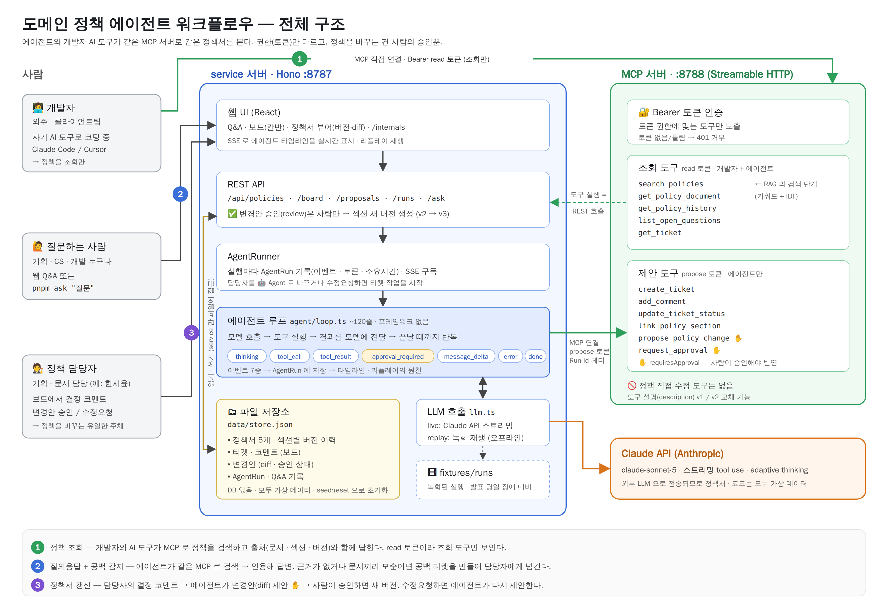

# 도메인 정책 에이전트 워크플로우

도메인을 모르는 개발자가 **정책을 묻고 → 근거와 함께 답을 받고 → 정책 공백은 티켓이 되고 → 개발 중 결정된 내용이 사람 승인을 거쳐 정책서에 반영되는** 흐름을 에이전트로 만든 데모입니다.
정책 지식은 **원격 MCP 서버**로 노출해서, 우리 에이전트와 외주 개발자의 AI 코딩 도구(Claude Code, Cursor)가 **같은 서버**를 씁니다.



> 모든 정책 문서는 가상의 헬스케어 앱을 위해 지어낸 데이터입니다. 실제 회사 정책이 아닙니다.

```
apps/service   REST API + 에이전트 루프 (+ 운영에서 웹 UI 서빙) :8787
apps/mcp       원격 MCP 서버 (Streamable HTTP, Bearer)      :8788
apps/web       웹 UI (React + Vite, 개발 중 dev server)       :5173
packages/core  도메인 모델, 파일 저장소, 검색, 시드
docs/          팀 설명용 문서
```

## 빠르게 띄우기

```bash
pnpm install
cp .env.example .env        # ANTHROPIC_API_KEY 만 채운다
pnpm dev                    # service + mcp + web 동시 기동 → http://localhost:5173

# 다른 터미널에서
pnpm ask "만 14세 미만 사용자는 검진 예약을 스스로 할 수 있나요?"
pnpm ask --verbose "..."    # 도구 결과 원문까지 출력
```

### 데모 시나리오

1. **Q&A** — "만 14세 미만 사용자는 검진 예약을 스스로 할 수 있나요?" → 문서 간 모순을 찾아 인용과 함께 답하고, 정책 공백 티켓을 만든다.
2. **보드** — T-4(보호자용 자녀 결과 열람 화면)의 담당자를 🤖 Agent 로 바꾼다 → 에이전트가 정책을 조사해 코멘트를 남기고, 모순을 별도 티켓으로 올린 뒤 In Review 로 옮긴다.
3. **정책서 갱신** — 1에서 생긴 공백 티켓에 담당자로서 결정을 코멘트하고("결정: 만 14세 미만도 법정대리인 동의 시 가입 허용") 🤖 에이전트에게 맡긴다
   → 변경안(diff) 제출, Needs Approval → 승인 / 수정요청 / 거절 → 승인하면 정책서 새 버전과 변경 이력.
4. **Internals** — 실행 기록과 타임라인, 토큰, MCP 도구 목록과 description v1/v2 비교.

상태는 `data/store.json` 파일 하나에 저장됩니다 (DB 없음). 시드로 되돌리려면 서버를 끄고 `pnpm seed:reset`.

## 내 AI 코딩 도구에 MCP 연결하기

Claude Code:

```bash
claude mcp add --transport http kb-policy http://localhost:8788/mcp \
  --header "Authorization: Bearer dev-read-token"
```

`dev-read-token` 은 읽기 전용 토큰이라 조회 도구만 보입니다. 자세한 내용은 [docs/02-mcp.md](docs/02-mcp.md).

## 키 없이 / 오프라인으로 시연하기

```bash
pnpm seed:reset
LLM_MODE=replay pnpm dev     # fixtures/runs 의 녹화된 모델 응답을 재생 (도구는 실제로 실행)
```

`fixtures/runs` 의 기본 4개는 스크립트로 만든 샘플이다. 발표 전에 실제 키로 다시 녹화한다 → [docs/04](docs/04-observability.md).

## 배포

`render.yaml` (Render Blueprint): Web Service 2개, DB 없음. 환경변수는 키만 정의돼 있다 → [docs/06](docs/06-try-it.md#render-배포).

## 문서

| 문서 | 내용 |
|---|---|
| [00-overview](docs/00-overview.md) | 아키텍처, 두 서버의 역할, 데이터 흐름 |
| [01-agent-loop](docs/01-agent-loop.md) | 에이전트 루프 한 줄씩 — 프레임워크 없이 이게 전부 |
| [02-mcp](docs/02-mcp.md) | MCP, 도구 설계와 description 요령, Claude Code / Cursor 연결 |
| [03-hitl](docs/03-hitl.md) | 사람이 개입하는 지점과 승인 정책 |
| [04-observability](docs/04-observability.md) | 이벤트 스트림, AgentRun, /internals, 리플레이 |
| [05-build-log](docs/05-build-log.md) | 만들어가는 순서와 결정 기록 (커밋 단위) |
| [06-try-it](docs/06-try-it.md) | 5분 셋업, 도구 추가 실습, Render 배포 |
| [07-demo-rehearsal](docs/07-demo-rehearsal.md) | 발표 시연 순서, 체크리스트, 장애 대응 |
