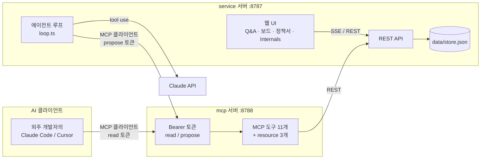
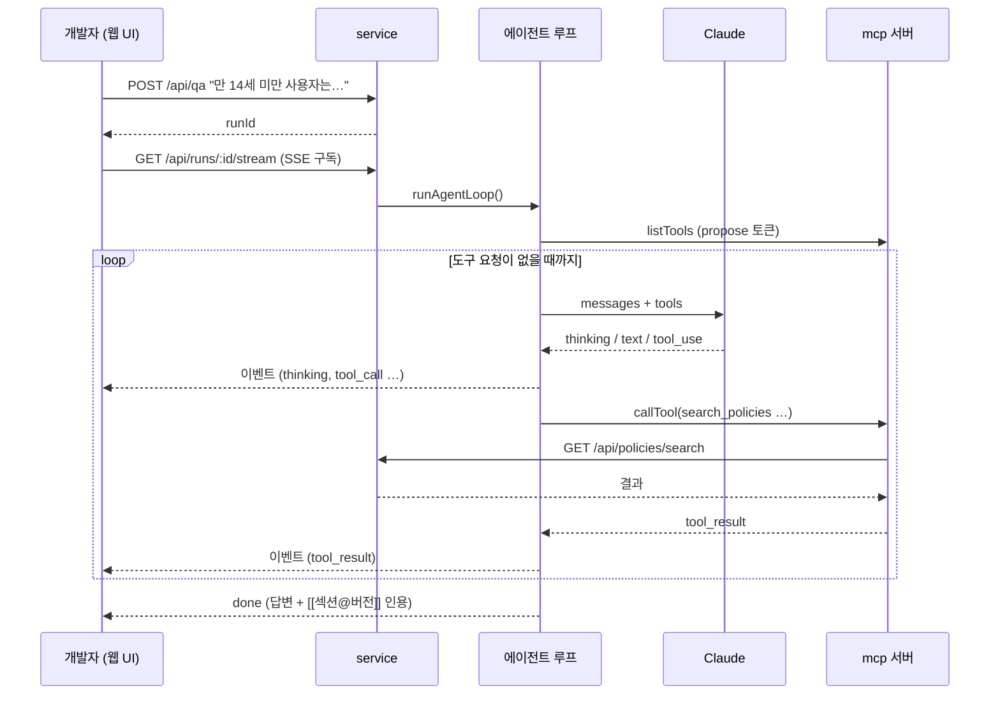

# 00. 전체 구조

## 무엇을 해결하나

도메인을 모르는 개발자(외주 포함)가 기획·정책을 이해하는 비용, 그리고 개발 중에 결정된 정책이 문서에 반영되지 않는 문제.

| 시나리오 | 흐름 |
|---|---|
| ① 정책 질의응답 | 질문 → 정책 검색 → **출처(섹션@버전)와 함께** 답변 |
| ② 정책 공백 감지 | 근거 없음/모순 → 답을 지어내지 않고 **정책 공백 티켓** 생성 → 담당자 배정 |
| ③ 정책서 갱신 | 티켓 코멘트의 결정 → 에이전트가 **변경안(diff)** 제안 → 사람 승인 → 새 버전 + 이력 |

## 아키텍처



**핵심 그림: 우리 에이전트도 외주 개발자의 AI 도구와 "같은 MCP 서버"를 쓴다.**
도구를 코드에서 직접 부르지 않는다. 그래서 도구를 고치면 우리 에이전트와 외주 개발자 모두에게 똑같이 반영되고,
권한(토큰)만 다르게 준다.

## 두 서버의 역할

| | service | mcp |
|---|---|---|
| 하는 일 | 상태 저장, REST API, 에이전트 실행, 웹 UI 서빙 | 도구 정의(이름·설명·입력 스키마·권한) 제공과 호출 전달 |
| 상태 | 있음 (`data/store.json`) | 없음 (요청마다 새로 만든다) |
| 인증 | 없음 (데모: 이름 선택) | Bearer 토큰 필수, 토큰별 권한 |
| 코드 | `apps/service`, `apps/web` | `apps/mcp` |

공통 도메인 로직(모델, 저장소, 검색, 변경안)은 `packages/core`.

## 데이터 흐름 — 시나리오 ① 한 번



## 저장소 구조

```
apps/service/src/agent/   loop.ts(루프) llm.ts(모델 호출) mcpClient.ts runner.ts(기록) replay.ts systemPrompt.ts
apps/service/src/api/     policies, board, proposals, runs, internals
apps/mcp/src/             index.ts(서버+인증) tools/(policy, board) descriptions/(v1, v2) resources.ts
apps/web/src/             pages/(Qa, Board, Policies, Internals) components/(Timeline, DiffView, ProposalCard)
packages/core/src/        types, store, policies, search, board, proposals, diff, seed/
fixtures/runs/            리플레이용 녹화 실행
```

## 의도적으로 하지 않은 것

- **에이전트 프레임워크(LangChain 등):** 루프가 추상화 뒤로 숨어 설명이 어려워진다. 이 규모에서는 120줄이면 된다 → [01](01-agent-loop.md)
- **DB:** 데모/교재용이라 JSON 파일 하나로 충분하다. 재배포하면 시드로 초기화된다.
- **로그인:** 이름 선택으로 대체. MCP 쪽만 토큰 인증을 한다.
- **임베딩 검색:** 조사 제거 + IDF 키워드 검색으로 시작했다. 문서가 수백 개로 늘면 그때 넣는다.
