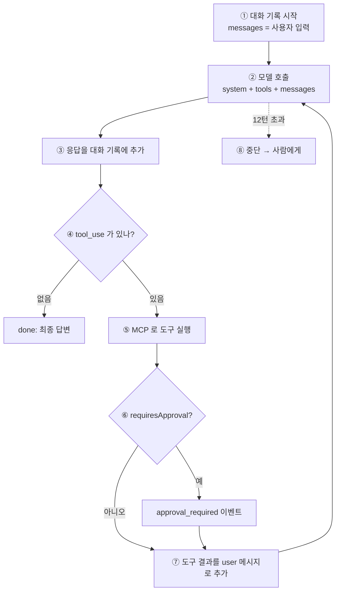

# 01. 에이전트 루프 — 프레임워크 없이, 이게 전부다

> 에이전트 = 모델에게 묻고 → 모델이 도구를 달라고 하면 실행해서 결과를 돌려주고 → 반복.
> 모델이 더 이상 도구를 달라고 하지 않으면(= 최종 답을 쓰면) 끝난다.

코드: [`apps/service/src/agent/loop.ts`](../apps/service/src/agent/loop.ts) (약 120줄, 주석 ①~⑧)



## 한 줄씩

### ① 대화 기록

```ts
const messages: Anthropic.MessageParam[] = [{ role: "user", content: input }];
```

모델은 기억이 없다. **매 턴 지금까지의 대화 전체를 다시 보낸다.** "에이전트의 기억"은 이 배열이 전부다.
(그래서 긴 작업은 비용이 커진다 → 매 턴 같은 부분(tools + system)은 prompt caching 으로 할인받는다: `llm.ts` 의 `cache_control`)

### ② 모델 호출

```ts
const message = await callModel(
  { system, tools: toolbox.tools, messages },
  { onThinking: …emit("thinking"), onText: …emit("message_delta"), onRetry: …emit("error") },
);
```

- `tools` 에는 MCP 서버에서 받아온 도구 정의(이름, description, 입력 JSON Schema)가 들어간다.
  모델은 **이름과 description 만 보고** 어떤 도구를 쓸지 고른다 → description 이 곧 사용 설명서다 ([02](02-mcp.md)).
- 스트리밍으로 받으면서 생각(thinking 요약)과 답변 조각을 **이벤트로 흘려보낸다.** 루프는 화면을 그리지 않는다.
- 모델 호출의 세부(스트리밍, 재시도, 리플레이)는 `llm.ts` 로 뺐다. 루프는 "무엇을 할지"만 담당한다.

### ③ 응답을 대화 기록에 추가

```ts
messages.push({ role: "assistant", content: message.content });
```

thinking 블록까지 **수정하지 않고 그대로** 붙인다. 모델이 다음 턴에 자기 추론을 이어가려면 원본이 필요하다.

### ④ 끝났나?

```ts
const toolUses = message.content.filter((b) => b.type === "tool_use");
if (message.stop_reason !== "tool_use" || toolUses.length === 0) { emit("done"); return; }
```

종료 조건은 코드가 정하지 않는다. **모델이 도구를 더 이상 요청하지 않으면 끝이다.**
`max_tokens`(잘림), `refusal`(거절)도 여기서 걸러 에러 이벤트로 남긴다.

### ⑤ 도구 실행

```ts
emit({ type: "tool_call", … });
const result = await toolbox.call(call.name, call.input);   // → MCP 서버
emit({ type: "tool_result", ok, summary, output, durationMs });
```

실행은 MCP 서버가 한다. 도구가 실패해도 루프는 멈추지 않는다: `is_error: true` 로 돌려주면 **모델이 에러를 읽고 다른 방법을 시도한다.**
(예: 없는 섹션 키 → 404 메시지 → 모델이 검색부터 다시)

### ⑥ 승인이 필요한 도구

```ts
if (result.ok && toolbox.requiresApproval(call.name)) emit({ type: "approval_required", … });
```

도구 이름을 하드코딩하지 않고, MCP 도구 정의의 `_meta.requiresApproval` 설정을 본다.
이 도구들은 "승인 대기" 상태만 만들 뿐 실제 반영은 하지 않는다. 루프는 **기다리지 않고** 계속 진행한다 → 이유는 [03](03-hitl.md).

### ⑦ 도구 결과를 돌려준다

```ts
messages.push({ role: "user", content: results });
```

도구 결과는 **user 메시지**로 들어간다. 모델이 한 번에 여러 도구를 요청했으면(병렬 호출) 결과를 **한 메시지에 모아서** 돌려준다.
그리고 ②로 돌아간다.

### ⑧ 안전장치

12턴을 넘으면 추측으로 마무리하지 않고 실패로 끝낸다. 사람이 넘겨받는다.

## 이게 전부인가?

루프 자체는 이게 전부다. 나머지는 루프 **바깥**에 있다.

| 관심사 | 위치 | 루프가 아는가 |
|---|---|---|
| 모델 호출, 재시도, 리플레이 | `llm.ts`, `replay.ts` | `callModel()` 만 안다 |
| 도구 목록과 호출 | `mcpClient.ts` → mcp 서버 | `toolbox` 인터페이스만 안다 |
| 실행 기록 저장, 실시간 구독 | `runner.ts` | `emit()` 만 안다 |
| 역할과 행동 원칙 | `systemPrompt.ts` | 문자열로 받는다 |
| 화면 | `apps/web` | 모른다 |

프레임워크가 해주는 일도 결국 이 표의 각 칸이다. 직접 쓰면 각 칸이 눈에 보인다.

## 이벤트

루프가 내보내는 이벤트 7종이 UI·CLI·리플레이의 공통 언어다 ([04](04-observability.md)).

| 이벤트 | 언제 |
|---|---|
| `thinking` | 모델의 생각 요약 조각 |
| `message_delta` | 답변 텍스트 조각 |
| `tool_call` | 도구 호출 직전 (이름, 인자) |
| `tool_result` | 도구 결과 (성공 여부, 요약, 원문, 소요 시간) |
| `approval_required` | 사람 승인이 필요한 도구가 실행됨 |
| `error` | 재시도(`retryable`) 또는 실패 |
| `done` | 종료 (최종 답변, 종료 이유) |

## 직접 해보기

```bash
pnpm ask --verbose "야간에 결과 등록 알림을 보내도 되나요?"
```

터미널에 ②~⑦이 몇 번 도는지 보인다.
