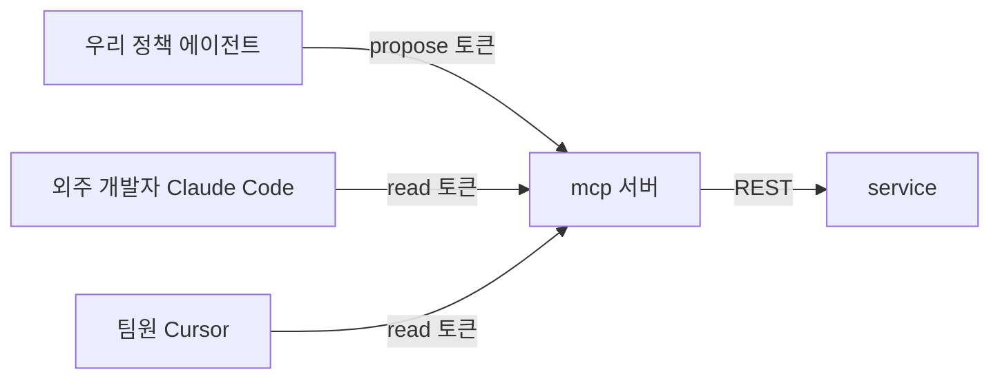

# 02. MCP — 정책 지식을 "도구"로 내보내기

## MCP 가 뭔가

**Model Context Protocol.** AI 클라이언트(Claude Code, Cursor, 우리 에이전트)가 외부 도구와 데이터에 붙는 표준 규약이다.
서버는 "나는 이런 도구와 자료가 있다"(`tools/list`, `resources/list`)를 알려주고, 클라이언트의 모델이 필요할 때 도구를 호출한다(`tools/call`).

한 번 MCP 서버로 만들어 두면, **어떤 AI 클라이언트든** 같은 도구를 쓸 수 있다.

## 왜 서버를 분리했나

1. **외주 개발자가 자기 AI 도구에서 우리 정책을 참조하게 하려고.** 우리 웹 UI 에 들어오지 않아도, 코딩하던 Claude Code 안에서 "이 화면 만 14세 미만이면 어떻게 해야 해?"를 물을 수 있다.
2. **우리 에이전트도 같은 서버를 쓰게 하려고.** 도구가 한 곳에 있으니, 도구를 고치면 모두에게 똑같이 반영된다. 우리 에이전트만 쓰는 비밀 경로가 없다.
3. **권한을 토큰으로 나누려고.** 같은 서버, 다른 토큰 → 보이는 도구가 다르다.



## 도구 목록 (11개)

| 도구 | 권한 | 승인 | 역할 |
|---|---|---|---|
| `search_policies` | read | - | 키워드 검색 → 섹션 id 와 스니펫 |
| `get_policy_document` | read | - | 문서 전체 또는 섹션 전문 (버전 지정 가능) |
| `get_policy_history` | read | - | 섹션의 모든 버전과 변경 이유 |
| `list_open_questions` | read | - | 미해결 정책 공백 티켓 |
| `get_ticket` | read | - | 티켓, 코멘트, 연결 섹션, 변경안 이력 |
| `create_ticket` | propose | - | 정책 공백/질문 티켓 생성 |
| `update_ticket_status` | propose | - | todo / in_progress / in_review 만 (done 없음) |
| `add_comment` | propose | - | 조사 결과, 근거 |
| `link_policy_section` | propose | - | 티켓 ↔ 섹션 연결 |
| `propose_policy_change` | propose | ✋ | 섹션 변경안 제출 (문서는 안 바뀜) |
| `request_approval` | propose | ✋ | Needs Approval 로 전환 |

**없는 도구가 더 중요하다.**
- 정책 문서를 직접 수정하는 도구: 없다. 변경은 `propose_policy_change` → 사람 승인뿐.
- 티켓을 done 으로 옮기는 도구: 없다 (`update_ticket_status` 의 enum 에서 뺐다).
- 변경안을 승인하는 도구: 없다.

> **권한 밖의 일은 프롬프트로 "하지 마"라고 하는 것보다, 도구를 주지 않는 것이 가장 확실한 통제다.**
> 모델에게 부탁한 규칙은 어겨질 수 있지만, 없는 도구는 호출할 수 없다.

도구 정의: [`apps/mcp/src/tools/`](../apps/mcp/src/tools/). 한 도구 = 이름 + 권한(scope) + `requiresApproval` + 입력 스키마(zod) + 핸들러.

## description 작성 요령

모델은 **도구 이름과 description 만 보고** 도구를 고른다. 외주 개발자의 Claude Code 는 우리 시스템 프롬프트를 모른다.
**description 은 모든 클라이언트에 전달되는 유일한 사용 설명서다.**

v2 description 은 모두 이 네 칸을 채운다 ([`descriptions/v2.ts`](../apps/mcp/src/descriptions/v2.ts)).

| 칸 | 예: `create_ticket` |
|---|---|
| 무엇을 하나 | 보드에 새 티켓을 만든다. 주 용도는 정책 공백/모순을 담당자에게 확인 요청하는 것 |
| 언제 쓰나 | 근거가 없거나 두 문서가 충돌해서 사람이 결정해야 할 때 |
| **쓰지 말 것** | list_open_questions 로 중복 확인 전에는 쓰지 않는다. 근거가 충분한 질문에는 쓰지 않는다 |
| 반환 형식 | `{ ticketId, ticket }` |

요령:
- **"쓰지 말 것"이 가장 효과가 크다.** 비슷한 도구끼리의 경계를 적는다 (search vs get, create_ticket vs add_comment).
- **다음 도구를 알려준다.** `propose_policy_change` 의 반환에 "이어서 request_approval 을 호출한다".
- **반환 형식을 적는다.** 모델이 결과에서 무엇을 꺼내 인용해야 하는지 안다 (`sectionId` 를 그대로 인용).
- **도구 결과에도 지침을 싣는다.** `request_approval` 결과의 `next` 필드: "기다리지 말고 마무리하세요".

### 실험: v1 vs v2

v1 은 "정책을 검색합니다." 수준의 한 줄 설명이다 ([`descriptions/v1.ts`](../apps/mcp/src/descriptions/v1.ts)).

```bash
TOOL_DESCRIPTIONS=v1 pnpm dev    # 대충 쓴 설명
TOOL_DESCRIPTIONS=v2 pnpm dev    # 기본값
```

같은 질문을 던져서 `/internals` 에서 비교한다: 도구 호출 순서, 중복 티켓 생성 여부, 검색 전에 섹션을 추측해서 조회하는지, 턴 수와 토큰.
`/internals → MCP 도구 → v1/v2 나란히 보기` 로 설명 자체도 비교할 수 있다.

도구 수도 같은 원리다. 도구가 많아질수록 비슷한 도구 사이에서 잘못 고를 확률이 오른다. 그래서 11개로 유지했다.

## resource

도구 호출 없이 "읽어두는" 배경 지식. Claude Code 에서는 `@` 로 첨부할 수 있다.

| URI | 내용 |
|---|---|
| `policy://glossary` | 도메인 용어집 (수검자, 가족 연결, 법정대리인…) |
| `policy://documents` | 문서 목록, 각 문서의 역할과 담당자, 섹션 키 |
| `policy://writing-rules` | 정책 작성 규칙 (변경안 제안 전에 읽는다) |

## 인증과 권한

```
Authorization: Bearer <token>
```

토큰은 mcp 서버의 `MCP_TOKENS` 환경변수로 발급한다.

```bash
MCP_TOKENS=dev-read-token:read:외주개발자,dev-agent-token:propose:policy-agent
#          토큰          :권한:이름
```

- 토큰이 없거나 틀리면 401.
- `read`: 조회 도구 5개만 보인다. 외주 개발자에게 발급한다.
- `propose`: 11개 모두. 우리 에이전트가 쓴다.
- 요청마다 McpServer 를 새로 만들고 **권한에 맞는 도구만 등록한다.** 그래서 read 토큰에는 쓰기 도구가 목록에조차 없다.

운영에서는 토큰을 긴 난수로 바꾼다: `openssl rand -hex 24`.

## 연결하기

### Claude Code

```bash
claude mcp add --transport http kb-policy http://localhost:8788/mcp \
  --header "Authorization: Bearer dev-read-token"
```

팀 프로젝트에 공유하려면 저장소 루트의 `.mcp.json` (토큰은 각자 환경변수로):

```json
{
  "mcpServers": {
    "kb-policy": {
      "type": "http",
      "url": "https://<mcp 서비스 주소>/mcp",
      "headers": { "Authorization": "Bearer ${KB_POLICY_TOKEN}" }
    }
  }
}
```

연결 확인: Claude Code 에서 `/mcp` → `kb-policy` 의 도구 목록. 그리고 이렇게 물어본다.

> 보호자용 자녀 결과 화면을 만들고 있어. 만 16세 자녀 결과를 보호자에게 보여줘도 되는지 kb-policy 로 확인해줘.

### Cursor

`.cursor/mcp.json`:

```json
{
  "mcpServers": {
    "kb-policy": {
      "url": "http://localhost:8788/mcp",
      "headers": { "Authorization": "Bearer dev-read-token" }
    }
  }
}
```

### MCP Inspector (디버깅)

```bash
npx @modelcontextprotocol/inspector
# Transport: Streamable HTTP, URL: http://localhost:8788/mcp, Header: Authorization: Bearer dev-read-token
```

## 서버 구현 포인트

[`apps/mcp/src/index.ts`](../apps/mcp/src/index.ts)

- `@modelcontextprotocol/sdk` 의 `WebStandardStreamableHTTPServerTransport` + Hono.
- **stateless** (`sessionIdGenerator: undefined`): 세션을 기억하지 않아서 Render 재시작이나 인스턴스 증설에 안전하다.
- 도구 핸들러는 service REST API 를 호출할 뿐이다. 에러는 `isError: true` 로 돌려준다 (모델이 읽고 대응).
- 쓰기 요청에는 호출자 정보를 싣는다: propose 토큰 = 에이전트 (+ `X-Agent-Run-Id` 로 받은 실행 id).
