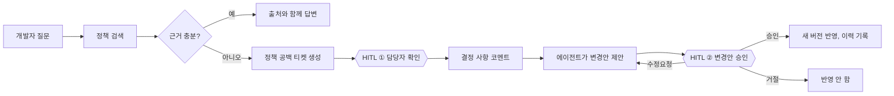

# 03. 사람이 개입하는 지점 (HITL)

## 원칙

**에이전트는 결정하지 않는다. 결정이 필요하다는 사실을 정확히 전달하고, 결정된 것을 문서로 옮긴다.**



| 지점 | 무엇을 사람이 하나 | 코드 |
|---|---|---|
| ① 정책 공백 확인 | 공백 티켓이 문서 담당자에게 자동 배정됨 → 담당자가 결정을 코멘트로 남김 | `BoardService.createTicket` (담당자 자동 배정) |
| ② 변경안 승인 | diff 를 보고 승인 / 수정요청(이유 필수) / 거절(이유 필수) | `ProposalService.review`, 웹 `ProposalCard` |
| ③ 추측 금지 | 근거가 없으면 답하지 않고 사람에게 넘김. 12턴 넘으면 중단 | `systemPrompt.ts`, `loop.ts` ⑧ |
| (+) 완료 판단 | 티켓을 done 으로 옮기는 건 사람만 | `update_ticket_status` enum 에 done 없음 |

## 어떻게 정했나

**되돌리기 어려운 것, 책임이 필요한 것 → 사람.**

- 정책서 변경: 개발·운영·법무에 영향. 누가 승인했는지 기록이 필요하다 → 승인자가 변경 이유에 남는다.
- 정책 공백의 결정: 도메인 판단. 에이전트가 그럴듯한 답을 지어내는 게 가장 위험하다.
- 조회, 코멘트, 티켓 생성, 섹션 연결: 틀려도 사람이 바로 보고 고칠 수 있다 → 에이전트에게 맡긴다.

## 통제는 세 겹

1. **도구를 주지 않는다.** 정책 직접 수정, 승인, done 이동 도구가 없다. (가장 확실)
2. **서버에서 거부한다.** 변경안 검토 API 는 에이전트 호출이면 403. 기준 버전이 다르면 409.
3. **프롬프트와 description 으로 안내한다.** "결정이 없으면 제안하지 말고 티켓으로". (가장 약하다 — 1, 2 를 보조)

## 승인 정책 설정

승인이 필요한지는 코드 곳곳에 흩어진 if 문이 아니라 **도구 정의의 설정값**이다.

```ts
// apps/mcp/src/tools/policy.ts
export const proposePolicyChange = defineTool({
  name: "propose_policy_change",
  scope: "propose",          // 이 권한의 토큰에만 보인다
  requiresApproval: true,    // 사람 승인 후에야 반영된다
  ...
});
```

- `requiresApproval` 은 MCP 도구의 `_meta` 로 클라이언트에 전달된다.
- 루프는 이 값만 보고 `approval_required` 이벤트를 낸다 (`loop.ts` ⑥). 도구 이름을 모른다.
- 새 도구를 추가할 때 이 두 값(`scope`, `requiresApproval`)을 정하는 것이 곧 HITL 설계다.

## 왜 루프가 승인을 "기다리지" 않나

`request_approval` 을 부르면 티켓을 Needs Approval 로 옮기고 **실행을 끝낸다.**

- 사람의 검토는 몇 분~며칠 걸린다. 그동안 LLM 대화를 붙잡아 두면 비용, 타임아웃, 서버 재시작 문제가 생긴다.
- 대신 **상태를 보드에 저장한다** (티켓 상태, 변경안 pending, 코멘트).
- 수정요청이 오면 → 티켓 In Progress + 에이전트 담당이면 **새 실행**이 시작되고, `get_ticket` 으로 코멘트와 변경안 이력(검토 의견 포함)을 읽어 이어받는다.

**대화 기록이 아니라 보드가 에이전트의 장기 기억이다.** 사람도 같은 보드를 보고 있으니, 에이전트가 무엇을 근거로 움직이는지 투명하다.

## 승인되면 무엇이 남나

- 새 섹션 버전(active), 이전 버전(deprecated)은 그대로 남는다.
- 문서 버전 +1.
- 변경 이유: `{근거} (변경안 P-2, 티켓 T-5, 승인 한서윤)`
- 티켓 코멘트: `✅ 승인: P-2 — membership.age v3 로 반영했습니다.`
- 정책서 뷰어의 "변경 이력"에서 버전 간 diff.

기존 답변의 인용(`[[membership.age@2]]`)은 버전이 박혀 있어서, 나중에 보면 "그때는 v2 기준으로 답했다"는 게 드러난다.
